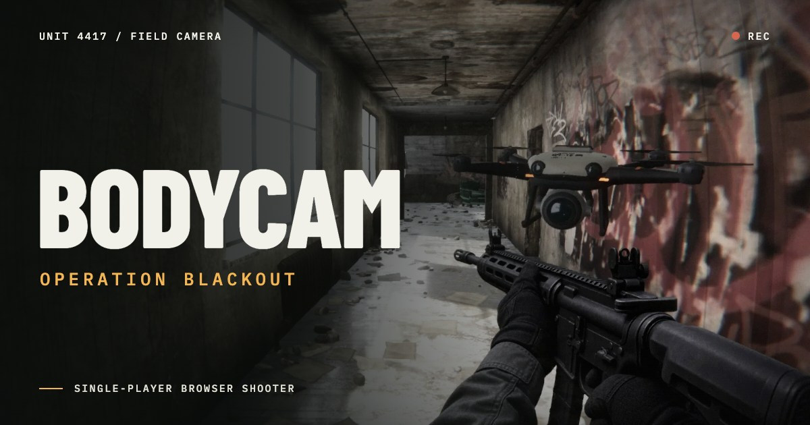

# Bodycam — Operation Blackout

[](https://nearbycoder.github.io/bodycam/)

**[Play in your browser](https://nearbycoder.github.io/bodycam/play/) · [Explore Operation Blackout](https://nearbycoder.github.io/bodycam/)**

A single-player Three.js arcade shooter set in a derelict industrial annex. The original body-camera corridor opens into a works floor with a motor bay, a utility basement, a records floor, and a rooftop plant. Two switchback stairwells connect the building.

Disable the inspection drones using the service pistol and compact carbine. A drone flashes before launching an energy orb. Cover blocks incoming fire and outgoing shots. Armor recovers between encounters. Redeployment retains disabled drones for the current run.

## Run locally

```sh
npm ci
npm run dev
```

Open the address Vite prints for the operation website, or open `/play/` for the game. The game requires WebGL 2. To try the production build locally, run `npm run build` followed by `npm run preview`.

## GitHub Pages

Pushes to `main` build both pages with Node.js 24 and publish `dist/` through GitHub Actions. The workflow uses the base path from the repository's Pages settings so direct links to the game, footage, and textures work under `/bodycam/`. [Deployment workflow](.github/workflows/pages.yml)

## Xbox controller

Connect an Xbox controller, open the game and press **A**. Use the D-pad and A in menus, and B to return. The game polls the browser's Gamepad API. Disconnecting the active controller during play pauses the encounter.

| Action | Xbox | Keyboard and mouse |
| --- | --- | --- |
| Move | Left stick | WASD |
| Look | Right stick | Mouse or arrow keys |
| Fire | RT | Left click or Space |
| Focus aim | LT | Right click |
| Reload | X | R |
| Switch weapon | RB | 1 for pistol, 2 for carbine |
| Tactical light | LB | F |
| Scan route to a drone | Y | Q |
| Sprint | Click left stick while moving forward | Hold Shift |
| Floor plan | View | Tab |
| Change displayed floor | D-pad left/right or bumpers | Left/right arrows |
| Pause / resume | Menu | Esc |
| Select menu entry | D-pad up/down, A | Up/down arrows, Enter |

The scanner follows a walkable route through doorways and stairs. The floor plan shows the operator, unresolved drone signals, and the current route. Touch controls support movement, looking, firing, scanning, reloading and weapon switching.

## Weapon handling

Press **X** on Xbox or **R** on the keyboard to watch the reload for the equipped weapon, including at full ammunition. Each weapon has its own reload, holster, draw and recoil timing. The hand, magazine and weapon animate separately. The ammunition count updates as the weapon returns to ready. Pausing freezes the action, and switching away during a reload preserves its progress.

[Watch the in-game handling capture](captures/weapon-handling.mp4)

## Graphics

Open **Graphics** from the main menu or pause menu. Choose a maximum texture edge of **512, 1024, 2048 or 4096 pixels** with the slider or D-pad. The default is 1024. Levels load on demand and the preference is saved in this browser. The 4K tier includes native-resolution scanned material detail. Some graffiti and foreground artwork originate from smaller regions of the 2560 × 1440 reference and use reconstructed fine detail. Geometric surfaces, light probes and interface elements have their own rendering resolutions.

The annex uses scanned concrete and bitumen with matched surface normals and roughness. The fluorescent lights account for equipment and walls that block their light. At 1K and above, damp floors reflect objects visible to the camera. The 2K and 4K settings also enable hardware edge smoothing on supported GPUs.

[Watch the 12-second in-engine graphics preview](captures/graphics-preview.mp4)

The motor bay on the works floor contains a parked coupe with a modeled interior, layered paint, glass and workshop reflections. The original guided route and source video remain available from **Camera archive**.

## Assets

- The body-camera footage and sampled photographic artwork derive from the supplied reference.
- The motor bay vehicle is adapted from *Car Concept* by Eric Chadwick / Darmstadt Graphics Group, based on Unity Fan's vehicle design, under CC BY 4.0. The vehicle directory contains attribution and modification details. [Vehicle credits](public/vehicles/CREDITS.txt)
- The hard-surface paint, roughness and displacement map derives from *Metal Plate 02* by Rob Tuytel, CC0. [Poly Haven](https://polyhaven.com/a/metal_plate_02)
- The rooftop panorama derives from *Teufelsberg Roof* by Greg Zaal, CC0. [Poly Haven](https://polyhaven.com/a/teufelsberg_roof)
- Carbine foreground artwork was generated with the built-in ImageGen tool. The brief called for a photographic, contemporary matte-black compact carbine, black fabric gloves and subdued window light on a transparent background. The pistol uses the supplied footage.
- Architectural texture detail uses *Concrete Wall 006* by Charlotte Baglioni and Dario Barresi, and *Concrete Floor Worn 001* by Dimitrios Savva and Rico Cilliers, CC0. [Wall](https://polyhaven.com/a/concrete_wall_006) · [Floor](https://polyhaven.com/a/concrete_floor_worn_001)
- The roofing surface uses the *Bitumen* scan by Rob Tuytel, CC0. [Poly Haven](https://polyhaven.com/a/bitumen)
- The website uses Barlow, Barlow Condensed, and IBM Plex Mono under the SIL Open Font License. [Font credits and licenses](public/credits/)
